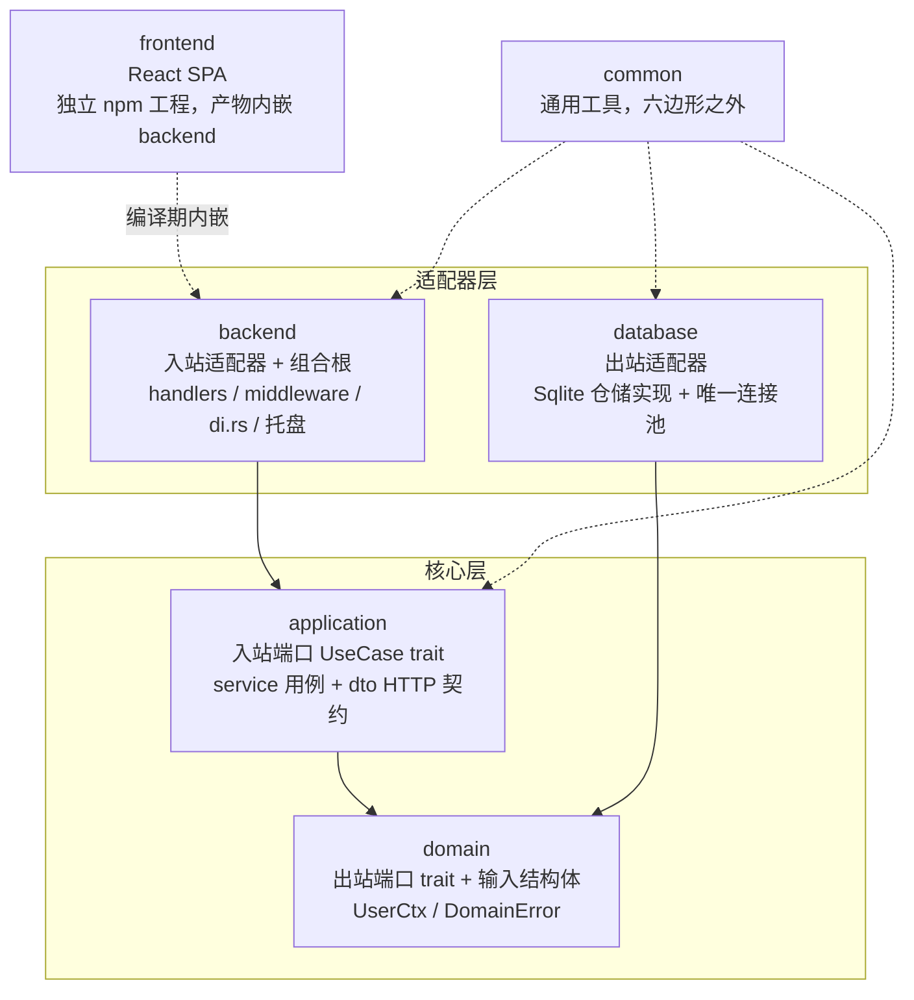

# Rust 全栈项目架构整合方案（脚手架）

**版本**: v2.0   **日期**: 2026-10-16   **适用技术栈**: Rust edition 2024 + Axum 0.8 + SQLite（sqlx 0.9）+ React 18 + AntD 5 + Vite 5

> 本方案以本仓库（食材采购验收系统）为蓝本，沉淀一套可直接复用的 **Rust 全栈脚手架**：严格六边形架构 + 单 exe 桌面交付（Win7 兼容）+ 内嵌 React SPA。新项目复制本骨架后，仅需替换业务域代码即可开工。
>
> 配套文档：[迁移指南-旧结构平滑过渡.md](./迁移指南-旧结构平滑过渡.md)（存量项目如何迁到本脚手架）、[六边形分层规则.md](./六边形分层规则.md)（分层 ADR）。

---

## 一、方案概述

本方案整合**严格六边形架构**、**Rust workspace 编译期边界**与**桌面单文件交付工程化**，核心取舍：

| 原则 | 落地方式 |
| --- | --- |
| **依赖倒置** | 依赖方向单向指向 domain；持久化、HTTP 均为可替换适配器 |
| **编译期边界** | crate 即边界——违规依赖在 `cargo build` 阶段即失败，不靠自觉 |
| **护栏自动化** | 5 条分层硬约束由脚本断言，任何变更后一键执行 |
| **行为基线** | 232 条冒烟断言锁定接口契约，重构不伤行为 |
| **单 exe 交付** | 前端产物编译期内嵌后端，静态链接 CRT，目标机器零依赖 |

**明确不做**（避免过度设计）：不补齐 DDD 战术模式（Aggregate/ValueObject/DomainEvent）；不引入 dyn 抽象（全部泛型单态化）；不引入 Docker/CI 重资产（单 exe 分发）；不为假想的多数据库预留抽象（SQLite 单实现，端口 trait 天然留出替换点）。

---

## 二、技术选型

| 分类 | 技术 | 选型理由 |
| --- | --- | --- |
| 语言 | Rust edition 2024，nightly 工具链 | build-std 需要 nightly；`rust-toolchain.toml` 固定 |
| HTTP 框架 | Axum 0.8 | 无宏路由、Tower 生态、类型安全 State 注入 |
| 数据库 | SQLite + sqlx 0.9 | 单文件零部署，桌面场景最优；异步驱动 |
| 前端 | React 18 + AntD 5 + TypeScript + Vite 5 | 心智统一、移动端自适应开箱；构建目标 chrome87 兼容 Win7 |
| 前端交付 | rust-embed | 产物编译期内嵌 `/app`，无静态文件分发问题 |
| 桌面集成 | tray-icon + tao | 系统托盘、开机自启等桌面能力 |
| Excel | rust_xlsxwriter（导出）/ calamine（导入） | 纯 Rust、无 COM 依赖 |
| 压缩 | flate2 | 内嵌文本资源 gzip 按需压缩 |
| 认证 | bcrypt + 会话 Cookie | 无外部依赖，离线可用 |
| 依赖注入 | 手动构造（di.rs 组合根） | Rust 类型系统天然支持，泛型单态化零运行时开销 |

---

## 三、架构设计

### 3.1 分层图



### 3.2 各层职责

| crate | 架构角色 | 职责 | 允许依赖 |
| --- | --- | --- | --- |
| `domain` | 核心 | **出站端口 trait**（`*Repo` / `*Store`）、端口自有的输入/行结构体、`UserCtx`、`DomainError` | **仅 serde** |
| `application` | 核心 | **入站端口 trait**（`*UseCase`）、service 用例编排、HTTP 契约 `*Req`（dto 目录）+ From 映射、`UseCaseError` | domain、common |
| `database` | 出站适配器 | 端口 trait 的 Sqlite 实现、连接池初始化、建表与数据修复 | domain、common |
| `backend` | 入站适配器 + **组合根** | handlers、middleware、路由、`di.rs`（唯一可触 `pool()` 处）、托盘、静态资源内嵌 | application、database、common |
| `common` | 横切工具 | 纯函数工具（时间、Excel、路径等），无业务语义 | 无业务 crate |
| `frontend` | 交付机制 | React SPA，独立 npm 工程（exclude 出 workspace） | —（不参与 Rust 依赖图） |

要点：
- **入站端口**在 `application/src/port`（UseCase trait），**出站端口**在 `domain/src/port`（Repo/Store trait）。
- **backend 不可扁平化进核心层**：它是交付机制（HTTP/托盘）与组合根，换掉交付形态时核心层零改动。
- **common 不是架构层**：六边形之外的横切工具，任何层可用，本身不引用业务。

---

## 四、项目目录结构

```plaintext
smcy/
├── Cargo.toml                  # workspace 根：resolver = "3"，5 个 crate 成员
├── rust-toolchain.toml         # channel = "nightly"
├── .cargo/config.toml          # win7 target + build-std + crt-static
├── make.ps1 / Makefile         # 任务入口（Windows / 类 Unix 一一对应）
├── scripts/
│   ├── check_layers.ps1        # 分层护栏：5 条硬约束断言
│   └── smoke.ps1               # 冒烟：232 条行为断言（隔离目录运行）
├── crates/
│   ├── common/src/utils/
│   ├── domain/src/
│   │   ├── port/               # 出站端口，按业务域一文件（本仓库 23 域）
│   │   ├── error.rs            # DomainError：4 变体，无 HTTP 语义
│   │   └── lib.rs              # UserCtx：角色 + user_id + 行级权限关联
│   ├── application/src/
│   │   ├── port/               # 入站端口 UseCase trait
│   │   ├── service/            # 用例实现（泛型注入 repo，单态化）
│   │   ├── dto/                # *Req HTTP 契约 + From<Req> for domain Input
│   │   └── error.rs            # UseCaseError：7 变体，含 From<DomainError>
│   ├── database/src/sqlite/
│   │   ├── mod.rs              # init_pool / pool()、建表、启动期数据修复
│   │   └── repo/               # Sqlite*Repo，按域对应 domain::port
│   ├── backend/src/
│   │   ├── main.rs             # 入口：路由注册、托盘、静态资源挂载
│   │   ├── di.rs               # 组合根：装配 App（全部 service + 共享 repo 句柄）
│   │   ├── api/                # handlers：State<App> 取用例，错误映射 HTTP
│   │   ├── middleware/         # 鉴权 / 权限点 / 审计（经 App 上的 repo 取数）
│   │   ├── pages/              # /legacy 旧服务端渲染页（迁移期保留）
│   │   └── app_assets.rs       # rust-embed 资源：gzip 缓存 + SPA 回退
│   └── frontend/               # React 工程（npm，被 workspace exclude）
│       ├── vite.config.ts      # base=/app/、target=chrome87、vendor 分包、dev 代理
│       └── src/{api,components,hooks,layouts,pages,stores,styles,utils}
└── .trae/
    ├── documents/              # 本方案 + ADR + 业务专题文档
    ├── rules/                  # 工作区规则（如提交规范）
    └── skills/                 # 固化的工程 Skill（hexagonal-layer-guard 等）
```

---

## 五、分层硬约束与护栏

### 5.1 五条硬约束（ADR 摘要，全文见《六边形分层规则.md》）

| # | 规则 | 断言方式 |
| --- | --- | --- |
| R1 | `domain/Cargo.toml` 依赖仅 serde | grep 依赖段 |
| R2 | `application/src` 无 `pool()` / `sqlx::` | 全量 grep |
| R3 | `domain/src` 无 `pub struct *Req`（HTTP 契约不落领域层） | 全量 grep |
| R4 | `backend/src` 除 `di.rs` 外无 `pool()`（组合根唯一） | 排除 di.rs 后 grep |
| R5 | `application/Cargo.toml` 无 `database` / `sqlx` 依赖 | grep 依赖段 |

执行：`.\make.ps1 check-layers`（退出码 0 = 全绿）。**任何 Rust 变更后必跑**，违规立即修复。护栏已固化为项目 Skill `hexagonal-layer-guard`。

### 5.2 持久化访问唯一路径

`database::pool()` 全局只允许在 `backend/src/di.rs` 出现一次。其余所有位置（含 middleware）必须经端口取数：

1. `di.rs` 把 repo 句柄挂到 `App` 结构体；
2. handler / middleware 从 `State<App>` 取；
3. 所有 SQL 封装在 `database/src/sqlite/repo/*.rs`。

### 5.3 依赖注入模式

泛型单态化，无 `dyn`：

```rust
// application/src/service/category.rs（示意）
pub struct CategoryService<R: CategoryRepo> { repo: R }

// backend/src/di.rs —— 组合根，装配具体类型
pub struct App {
    pub user_repo: SqliteUserRepo,            // 供中间件共享的句柄
    pub category: CategoryService<SqliteCategoryRepo>,
    // ... 按业务域聚合全部用例
}
```

中间件与用例共享的仓储句柄（如会话解析用的 `user_repo`、审计用的 `oplog_repo`）直接作为 `App` 字段暴露，杜绝中间件直连 pool。

### 5.4 错误映射链（单向）

```
DomainError (4 变体: NotFound / InvalidInput / Conflict / Storage，无 HTTP 语义)
  └─ From<DomainError> for UseCaseError
UseCaseError (7 变体: Business / BadRequest / Unauthorized / Forbidden / NotFound / Storage / RawResponse)
  └─ backend 适配器映射为 HTTP 状态码与响应体
```

下层禁止引入 `StatusCode`；状态码与文案由 backend 唯一决定。`RawResponse` 变体仅用于旧接口非标准错误契约的逐字节保持。

### 5.5 接口兼容红线

- 请求/响应 JSON 字段名与顺序**不得改变**（serde 序列化顺序 = 字段声明顺序）。
- 金额一律 `f64`，日期一律 `String('YYYY-MM-DD')`；不引入改变 JSON 形态的强类型值对象。
- `scripts/smoke.ps1` 的 232 条断言是行为不变性基线，任何整改后必须全绿才能提交。

---

## 六、新增业务模块标准路径（7 步）

严格按序执行，任何逆向都会触发护栏违规：

| 步骤 | 位置 | 动作 |
| --- | --- | --- |
| 1 | `domain/src/port/<mod>.rs` | 定义出站 trait + 自有输入/行结构体（不含 serde 职责） |
| 2 | `database/src/sqlite/repo/<mod>.rs` | 实现该 trait（Sqlite*Repo） |
| 3 | `application/src/dto/<mod>.rs` | 定义 `*Req` HTTP 契约（serde default）+ `From<Req> for Input` |
| 4 | `application/src/service/<mod>.rs` | 用例实现；入口 shadow：`let input = req.into();` |
| 5 | `application/src/port/<mod>.rs` | 定义入站端口 trait（可引用 `application::dto`） |
| 6 | `backend/src/api/handlers.rs` | handler 适配：`State<App>` 取用例，错误映射 HTTP |
| 7 | `backend/src/di.rs` | 注入 service + 必要的共享 repo 句柄 |

常见违规速查：

| 症状 | 修复 |
| --- | --- |
| application 出现 `sqlx::query` | SQL 搬到 database repo，domain 加 trait，注入调用 |
| middleware 出现 `pool()` | 签名加 `&App`，改经 App 上的 repo 取数 |
| domain 出现 `*Req` | 移到 application/dto，domain 端口定义自有输入结构体 |

---

## 七、前端工程规范

- **技术栈统一**：React 18 + AntD 5 + react-router 6 + zustand + dayjs + @tanstack/react-query；不混用手写 CSS 页面。
- **构建目标** `chrome87`（Win7 最后支持 Chrome 109，留裕量）；vite `manualChunks` 拆 react / antd vendor 分包。
- **交付**：`vite build` 产物由 backend 经 rust-embed 内嵌，`base` 固定 `/app/`；SPA 无扩展名路径回退 `index.html`；带 hash 产物 immutable 长缓存，文本类资源 gzip（按路径缓存压缩结果，回 `Vary: Accept-Encoding`）。
- **路由**：`BrowserRouter basename="/app"`；菜单 key 用 basename 相对路径。全屏移动页（如分拣页）走独立路由不挂 MainLayout。
- **移动适配**：`Grid.useBreakpoint`，`screens.md === false` 判定移动端（避免 PC 首帧断点未测量闪抽屉）。
- **开发**：`.\make.ps1 frontend-dev` 起 vite（5173），代理 `/api`、`/static` 到本地 80。
- 日期控件用 dayjs format 模式（`onChange` 内 `d.format('YYYY-MM-DD')`），不用 `valueFormat`。

---

## 八、桌面交付工程化（Win7 单 exe）

| 约束 | 实现 |
| --- | --- |
| Win7 兼容 | target `x86_64-win7-windows-msvc`（Tier 3），`build-std = ["std", "panic_abort"]` 源码编译 std，需 nightly |
| 零依赖 | `+crt-static` 静态链接 C 运行时，目标机器无需 VC++ Redistributable / Node |
| 单 exe | 前端内嵌 + CRT 静态链接，产物即 `food_accept_single.exe` 一个文件 |
| 工作目录 | 启动时锁定 exe 所在目录，数据库 / uploads / backups 始终生成在程序同级（不受快捷方式起始位置影响） |
| 端口回退 | 默认 80，被占用依次尝试 8080~8099；托盘「打开页面」读取实际运行端口 |
| 应用标识 | 嵌入专属图标与版本信息（资源管理器 / 任务栏 / exe 属性正确显示） |

关键配置文件：

```toml
# .cargo/config.toml
[build]
target = "x86_64-win7-windows-msvc"
[unstable]
build-std = ["std", "panic_abort"]
[target.x86_64-win7-windows-msvc]
rustflags = ["-C", "target-feature=+crt-static"]
```

---

## 九、开发流程与质量门禁

### 9.1 任务入口

| 命令 | 功能 |
| --- | --- |
| `.\make.ps1 check` | cargo check --workspace |
| `.\make.ps1 check-layers` | 分层护栏（5 条硬约束） |
| `.\make.ps1 release` | 前端构建 + cargo build --release |
| `.\make.ps1 run` | release 构建并启动 |
| `.\make.ps1 fmt` / `clippy` | 格式化 / lint |
| `.\make.ps1 frontend-build` / `frontend-dev` | 前端构建 / dev server |
| `.\scripts\smoke.ps1` | 冒烟 232 断言（隔离目录 `%TEMP%\smcy_smoke`，凭据 super_admin/admin123） |

### 9.2 提交前检查单

1. `.\make.ps1 check-layers` 全绿（改了 Rust 代码时）
2. `cd crates/frontend; npx tsc -b` 无错（改了前端时）
3. `.\scripts\smoke.ps1` PASS=232 FAIL=0（涉及接口行为时）
4. 提交信息遵循 Conventional Commits 混合模式：type 英文 + scope/描述中文，如 `feat(商品): 添加自动计算售价并同步基础单价功能`

---

## 十、脚手架复用指南

以本仓库为模板启动新项目：

1. **复制骨架**：`Cargo.toml`（workspace + resolver 3）、`rust-toolchain.toml`、`.cargo/`、`make.ps1`、`Makefile`、`scripts/`（护栏 + 冒烟框架）、`.trae/rules`、`.trae/skills/hexagonal-layer-guard`。
2. **保留空壳 crate**：common / domain / application / database / backend 五件套 + frontend（替换 app 名、base 路径、图标）。
3. **替换业务域**：按标准 7 步逐域重建 port / repo / dto / service / handler / di 注入；旧业务代码删除即完。
4. **重置数据层**：`database/src/sqlite/mod.rs` 建表脚本替换为新域 schema；种子账号按需保留。
5. **校准护栏基线**：冒烟断言按新接口重写，首轮全绿后锁定为行为基线。

脚手架的不可替代资产是**规则与门禁**（ADR、护栏脚本、冒烟基线、提交规范）——业务代码可以推倒，骨架与护栏必须原样继承。

---

## 十一、架构优势总结

| 优势 | 说明 |
| --- | --- |
| 领域纯净 | domain 仅依赖 serde，可独立测试 |
| 依赖倒置 | 适配器依赖端口，核心层不知 HTTP/SQL 存在 |
| 编译期边界 | 错误依赖直接编译失败；残留穿透由护栏脚本兜底 |
| 可测试性 | 用例泛型注入 repo，测试可注入内存实现 |
| 行为锁定 | 冒烟基线保障重构不伤接口契约 |
| 零部署 | 单 exe 内嵌全部资源，Win7 双击即用 |

---

## 版本历史

| 版本 | 日期 | 变更说明 |
| --- | --- | --- |
| v1.0 | 2026-05-20 | 初始模板态（Dioxus + PostgreSQL + Redis + Docker），已废弃 |
| v2.0 | 2026-10-16 | 以 smcy 仓库实际架构（严格六边形 + Axum + SQLite + React/AntD 内嵌 + Win7 单 exe）重写为完整脚手架方案 |
